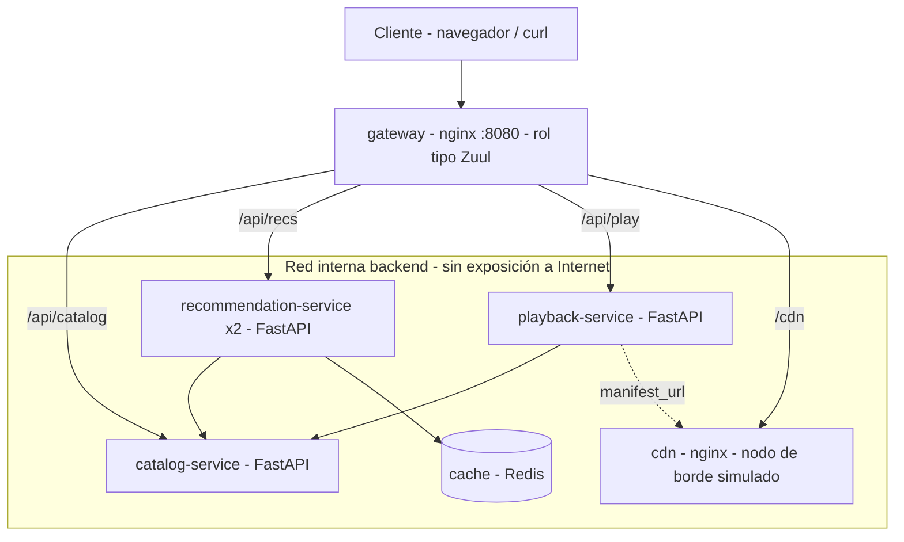
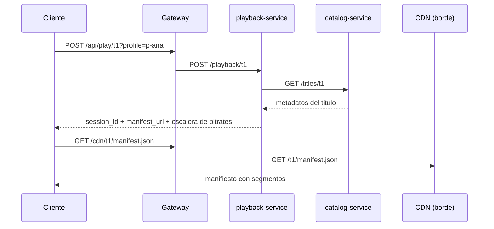
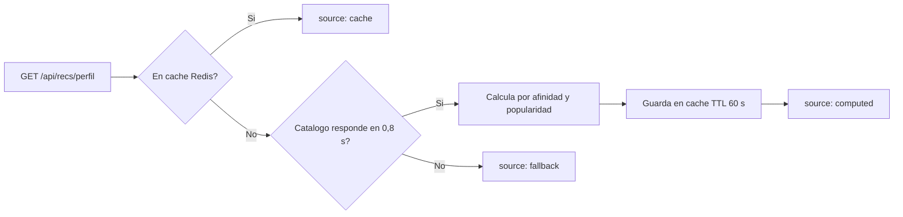

<div align="center">

# 🎬 Mini-Flix Lab – Plataforma de Streaming con Microservicios en Docker y Kubernetes

### *Gateway de borde, microservicios, caché distribuida, CDN simulado y degradación elegante*

**Módulo: Contenerización de Aplicaciones de Software · Politécnico Grancolombiano · Unidad 1**

[]()
[]()
[]()
[]()
[]()
[]()

**[Contexto](#-contexto-y-alcance) • [Contenido](#-contenido-del-repositorio) • [Tecnologías](#-tecnologías-utilizadas) • [Arquitectura](#️-arquitectura) • [Ejecución](#-ejecución-del-laboratorio) • [Kubernetes](#️-despliegue-en-kubernetes) • [Autor](#-autor)**


</div>

---

## 📋 Tabla de Contenidos

- [🎯 Contexto y Alcance](#-contexto-y-alcance)
- [📁 Contenido del Repositorio](#-contenido-del-repositorio)
- [🧰 Tecnologías Utilizadas](#-tecnologías-utilizadas)
- [🏗️ Arquitectura](#️-arquitectura)
- [🔁 Flujo de una Reproducción](#-flujo-de-una-reproducción)
- [🧩 De Netflix a Mini-Flix](#-de-netflix-a-mini-flix)
- [🚀 Ejecución del Laboratorio](#-ejecución-del-laboratorio)
- [🔌 Endpoints](#-endpoints)
- [🧪 Experimentos Sugeridos](#-experimentos-sugeridos)
- [☸️ Despliegue en Kubernetes](#️-despliegue-en-kubernetes)
- [✅ Buenas Prácticas Aplicadas](#-buenas-prácticas-aplicadas)
- [📝 Nota](#-nota)
- [👤 Autor](#-autor)

---

## 🎯 Contexto y Alcance

Este repositorio contiene el laboratorio **Mini-Flix**, desarrollado como complemento de la **Actividad Formativa de la Unidad 1: Aplicaciones contenerizadas**. Reproduce a pequeña escala los patrones arquitectónicos de **Netflix**: gateway de borde, microservicios independientes, caché distribuida, separación entre **plano de control** y **plano de datos (CDN)** y **degradación elegante** ante fallas.

Todo se despliega con **Docker Compose** en local, y se incluyen manifiestos de **Kubernetes** que muestran cómo llevar un servicio a un clúster gestionado de producción.

> **Caso de estudio:** Netflix — streaming global basado en microservicios y contenedores.
> **Enfoque:** contenerización, orquestación y patrones de resiliencia.
> **Alcance:** 3 microservicios FastAPI + gateway nginx + Redis + CDN simulado → 6 servicios y 7 contenedores en Docker Compose → Deployment con autoescalado de 3 a 30 réplicas en Kubernetes.

### 🌟 ¿Qué demuestra este laboratorio?

- 🚪 **Punto único de entrada** con un API Gateway que enruta y limita la tasa de peticiones.
- 📦 **Microservicios independientes**, cada uno con su propia imagen, healthcheck y límites de recursos.
- ⚡ **Caché distribuida** en Redis para no recalcular recomendaciones.
- 🛡️ **Degradación elegante**: si el catálogo cae, las recomendaciones siguen respondiendo con un *fallback*.
- 🌐 **Plano de control vs. plano de datos**: el servicio de reproducción no transmite video; indica al cliente desde qué nodo de borde descargarlo.
- ☸️ **Producción en Kubernetes** con actualización progresiva, sondas, autoescalado y presupuesto de disrupción.

---

## 📁 Contenido del Repositorio

<table align="center">
  <tr><th>Elemento</th><th>Descripción</th></tr>
  <tr><td colspan="2"><b>📂 raíz</b></td></tr>
  <tr><td><code>docker-compose.yml</code></td><td>🐳 Orquesta los 6 servicios (7 contenedores) con healthchecks, límites de CPU/memoria (cgroups), réplicas y una red interna aislada</td></tr>
  <tr><td><code>README.md</code></td><td>📄 Este documento</td></tr>
  <tr><td><code>.gitignore</code></td><td>🚫 Mantiene en local el material académico, los documentos editables y los temporales</td></tr>
  <tr><td colspan="2"><b>📂 services/</b></td></tr>
  <tr><td><code>catalog/</code></td><td>📚 <b>catalog-service</b> (Python + FastAPI): fuente de verdad de los metadatos de los 7 títulos</td></tr>
  <tr><td><code>recommendation/</code></td><td>🎯 <b>recommendation-service</b>: personalización por perfil, 2 réplicas, caché en Redis (TTL 60 s) y <i>fallback</i> si el catálogo falla</td></tr>
  <tr><td><code>playback/</code></td><td>▶️ <b>playback-service</b>: autoriza la reproducción y entrega la URL del manifiesto en el CDN</td></tr>
  <tr><td><i>en cada servicio</i></td><td>🧱 <code>app.py</code>, <code>Dockerfile</code> multi-etapa, <code>requirements.txt</code> con versiones fijadas y <code>.dockerignore</code></td></tr>
  <tr><td colspan="2"><b>📂 gateway/</b></td></tr>
  <tr><td><code>nginx.conf</code></td><td>🚪 API Gateway (rol análogo a <b>Zuul</b>): enrutamiento, limitación de tasa a 20 req/s y endpoint <code>/health</code></td></tr>
  <tr><td colspan="2"><b>📂 cdn/</b></td></tr>
  <tr><td><code>content/t1/manifest.json</code></td><td>🌐 Manifiesto servido por un nginx que simula un nodo de borde (análogo a un <b>OCA de Open Connect</b>)</td></tr>
  <tr><td colspan="2"><b>📂 k8s/</b></td></tr>
  <tr><td><code>namespace.yaml</code></td><td>🔒 Namespace <code>miniflix</code> con Pod Security Standard <code>restricted</code></td></tr>
  <tr><td><code>recommendation.yaml</code></td><td>☸️ Deployment, Service, HorizontalPodAutoscaler y PodDisruptionBudget del recommendation-service</td></tr>
  <tr><td colspan="2"><b>📂 tests/</b></td></tr>
  <tr><td><code>smoke_test.sh</code></td><td>🧪 Prueba de punta a punta de los 5 flujos y prueba de resiliencia deteniendo el catálogo</td></tr>
</table>

---

## 🧰 Tecnologías Utilizadas

<div align="center">


</div>

| Componente | Uso |
|:---|:---|
| **Docker Engine 24+ y Docker Compose v2** | Construcción de imágenes y orquestación local de los 7 contenedores |
| **Python 3.12 + FastAPI + Uvicorn** | Implementación de los microservicios `catalog`, `recommendation` y `playback` |
| **httpx** | Llamadas entre servicios con *timeout* de 0,8 s |
| **NGINX** | API Gateway de borde y servidor del CDN simulado |
| **Redis** | Caché distribuida de recomendaciones |
| **Kubernetes** | Despliegue de producción con autoescalado y alta disponibilidad |

---

## 🏗️ Arquitectura



El gateway es el único contenedor conectado a la red `edge` y con un puerto publicado (`8080`). Los demás viven en la red `backend`, declarada `internal: true`, y se descubren entre sí por el **DNS interno** de Docker.

---

## 🔁 Flujo de una Reproducción



El **plano de control** (`playback`) decide y autoriza; el **plano de datos** (`cdn`) entrega el contenido.

### Decisión de recomendaciones



---

## 🧩 De Netflix a Mini-Flix

| Concepto en Netflix | Equivalente en Mini-Flix |
|:---|:---|
| **Zuul** (gateway de borde) | `gateway` – nginx con enrutamiento y `limit_req` |
| **Eureka** (descubrimiento de servicios) | DNS interno de Docker / Kubernetes |
| **EVCache** (caché distribuida) | `cache` – Redis con TTL |
| **Hystrix** (degradación elegante) | Respuesta `fallback` del recommendation-service |
| **Open Connect / OCA** (CDN propio) | `cdn` – nginx que sirve el manifiesto |
| **Plano de control en AWS** | `playback` entrega la `manifest_url`, no el video |
| **Titus / contenedores a escala** | Docker Compose en local y Kubernetes en producción |

---

## 🚀 Ejecución del Laboratorio

1. Instalar **Docker Engine 24+** con **Docker Compose v2**.
2. Clonar el repositorio y ubicarse en la carpeta raíz:
   ```bash
   git clone https://github.com/AlejoTechEngineer/miniflix-docker-k8s-lab.git
   cd miniflix-docker-k8s-lab
   ```
3. Construir y levantar los contenedores:
   ```bash
   docker compose up -d --build
   ```
4. Verificar que todos los servicios estén en estado **healthy**:
   ```bash
   docker compose ps
   ```
5. Ejecutar la prueba de humo:
   ```bash
   ./tests/smoke_test.sh
   ```

---

## 🔌 Endpoints

Todos se consumen a través del gateway en `http://localhost:8080`.

| Método | Ruta | Servicio | Respuesta |
|:---:|:---|:---|:---|
| `GET` | `/health` | gateway | Estado del gateway |
| `GET` | `/api/catalog/titles` | catalog | Los 7 títulos (filtro opcional `?genre=drama`) |
| `GET` | `/api/catalog/titles/{id}` | catalog | Metadatos de un título |
| `GET` | `/api/recs/{perfil}` | recommendation | Recomendaciones con `source` y `served_by` |
| `POST` | `/api/play/{id}?profile={perfil}` | playback | `session_id`, `manifest_url` y escalera de bitrates |
| `GET` | `/cdn/{id}/manifest.json` | cdn | Manifiesto con los segmentos |

```bash
curl localhost:8080/api/catalog/titles
curl localhost:8080/api/recs/p-luis
curl -X POST "localhost:8080/api/play/t1?profile=p-ana"
curl localhost:8080/cdn/t1/manifest.json
```

---

## 🧪 Experimentos Sugeridos

<details>
<summary><b>🔎 Ver experimentos</b></summary>

| Experimento | Comandos | Qué observar |
|:---|:---|:---|
| 📈 **Escalado horizontal selectivo** | `docker compose up -d --scale recommendation=4` y luego `docker compose restart gateway` | El campo `served_by` alterna entre réplicas (nginx resuelve las réplicas al arrancar, por eso se reinicia el gateway) |
| 🛡️ **Resiliencia** | `docker compose stop catalog` y `curl localhost:8080/api/recs/p-nuevo` | La respuesta trae `source: fallback` en lugar de un error |
| ⚡ **Caché distribuida** | Consultar dos veces `curl localhost:8080/api/recs/p-ana` | La primera respuesta indica `source: computed` y la segunda `source: cache` |
| 📊 **Límites de recursos** | `docker stats` | Topes de 0,5 CPU y 256 MiB aplicados por cgroups a cada microservicio |

</details>

---

## ☸️ Despliegue en Kubernetes

```bash
kubectl apply -f k8s/namespace.yaml
kubectl apply -f k8s/recommendation.yaml
```

| Recurso | Configuración |
|:---|:---|
| **Namespace** | `miniflix`, con Pod Security Standard `restricted` |
| **Deployment** | 3 réplicas, `RollingUpdate` con `maxSurge: 1` y `maxUnavailable: 0` (actualización sin caída) |
| **Sondas** | `readinessProbe` y `livenessProbe` sobre `/health` |
| **Seguridad** | Usuario no root (UID 10001), sin escalamiento de privilegios y sistema de archivos de solo lectura |
| **Distribución** | `topologySpreadConstraints` para repartir réplicas entre zonas |
| **Recursos** | `requests` 250m CPU / 128Mi · `limits` 500m CPU / 256Mi |
| **HorizontalPodAutoscaler** | Entre **3 y 30 réplicas** al 65 % de uso de CPU |
| **PodDisruptionBudget** | Mínimo 2 réplicas disponibles durante mantenimientos |

> ℹ️ Los manifiestos cubren el **recommendation-service** como referencia de producción. Ajustar `image:` al registro de contenedores utilizado (EKS, AKS o GKE).

---

## ✅ Buenas Prácticas Aplicadas

| Práctica | Dónde se aplica |
|:---|:---|
| 🏗️ Imágenes **multi-etapa** sobre `python:3.12-slim` | `services/*/Dockerfile` |
| 📌 Versiones de dependencias e imágenes **fijadas** | `requirements.txt`, `docker-compose.yml` |
| 👤 Procesos con **usuario sin privilegios** (UID 10001) | Dockerfiles y `securityContext` en Kubernetes |
| ❤️ **Healthchecks** en imagen y en orquestador | `HEALTHCHECK`, `depends_on: service_healthy`, sondas de Kubernetes |
| 🔒 **Red interna** (`internal: true`): solo el gateway queda expuesto | `docker-compose.yml` |
| 🧭 Descubrimiento de servicios por **DNS interno** | Variables `CATALOG_URL` y `REDIS_URL` |
| 🚦 **Limitación de tasa** en el borde | `gateway/nginx.conf` |
| ⏱️ **Timeouts** cortos entre servicios | `httpx` con 0,8 s; Redis con 0,3 s |

---

## 📝 Nota

Este laboratorio corresponde a una **actividad académica** y se elaboró con fines exclusivamente formativos. Los nombres de títulos, perfiles y nodos de borde son ficticios, y la arquitectura de Netflix se reproduce de forma simplificada.

---

## 👤 Autor

<div align="center">

Este laboratorio fue desarrollado en el marco del módulo **Contenerización de Aplicaciones de Software** de la **Maestría en Arquitectura de Software** del **Politécnico Grancolombiano** (Bogotá, Colombia).

| Autor | Perfil |
|:---:|:---:|
| ***Alejandro De Mendoza*** | [](https://github.com/AlejoTechEngineer) |

</div>

---

<div align="center">

### 🎬 *Contenerizar es diseñar para fallar y escalar*

**Contenerización de Aplicaciones de Software · Mini-Flix Lab**

</div>
