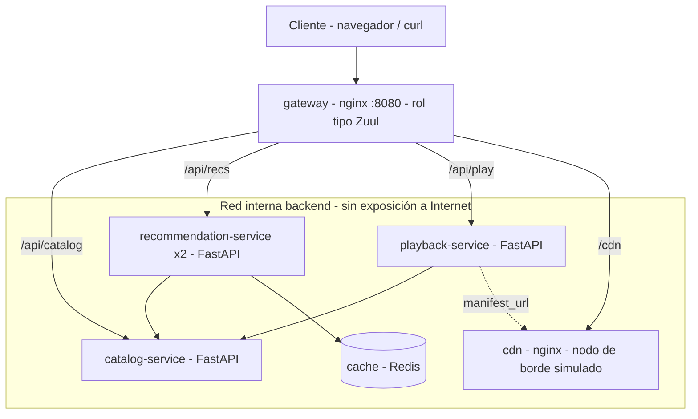

<div align="center">

# Mini-Flix Lab - Contenerización de Aplicaciones de Software - Plataforma de Streaming con Microservicios en Docker y Kubernetes

</div>

---

Este repositorio contiene el laboratorio **Mini-Flix**, desarrollado como complemento de la **Actividad Formativa de la Unidad 1: Aplicaciones contenerizadas**. Reproduce a pequeña escala los patrones arquitectónicos de **Netflix**: gateway de borde, microservicios independientes, caché distribuida, separación entre **plano de control** y **plano de datos (CDN)** y **degradación elegante** ante fallas. Todo se despliega con **Docker Compose** en local y con **Kubernetes** para un entorno de producción.

## Contenido del repositorio:

- `docker-compose.yml` → Orquesta los **6 contenedores** del laboratorio con healthchecks, límites de recursos (cgroups), réplicas y una red interna aislada.
- `services/catalog/` → **catalog-service** (Python + FastAPI): fuente de verdad de los metadatos de los títulos.
- `services/recommendation/` → **recommendation-service**: personalización por perfil, **2 réplicas**, caché en **Redis** y respuesta de **fallback** si el catálogo falla.
- `services/playback/` → **playback-service**: autoriza la reproducción y entrega la URL del manifiesto en el CDN (no transmite video).
- `gateway/nginx.conf` → **API Gateway** con nginx (rol análogo a **Zuul** en Netflix): enrutamiento y limitación de tasa.
- `cdn/content/` → Contenido servido por un nginx que simula un **nodo de borde** (análogo a un **OCA de Open Connect**).
- `k8s/` → Manifiestos de **Kubernetes**: Namespace con política de seguridad restringida, Deployment, Service, **HorizontalPodAutoscaler** y **PodDisruptionBudget**.
- `tests/smoke_test.sh` → Prueba de punta a punta y prueba de **resiliencia**.

## Arquitectura



## Ejecución del laboratorio:

1. Instalar **Docker Engine 24+** con **Docker Compose v2**.
2. Clonar el repositorio y ubicarse en la carpeta raíz.
3. Construir y levantar los contenedores: `docker compose up -d --build`
4. Verificar que todos los servicios estén en estado **healthy**: `docker compose ps`
5. Ejecutar la prueba de humo: `./tests/smoke_test.sh`

### Endpoints principales (a través del gateway en `http://localhost:8080`)

```bash
curl localhost:8080/api/catalog/titles
curl localhost:8080/api/recs/p-luis
curl -X POST "localhost:8080/api/play/t1?profile=p-ana"
curl localhost:8080/cdn/t1/manifest.json
```

## Experimentos sugeridos

- **Escalado horizontal selectivo:** `docker compose up -d --scale recommendation=4` y observar el campo `served_by` alternando entre réplicas.
- **Resiliencia:** `docker compose stop catalog` y consultar `/api/recs/p-nuevo`; el servicio responde con `source: fallback` en lugar de fallar.
- **Caché distribuida:** consultar dos veces `/api/recs/p-ana`; la segunda respuesta indica `source: cache`.
- **Límites de recursos:** `docker stats` muestra los topes de CPU y memoria aplicados por cgroups.

## Despliegue en Kubernetes

```bash
kubectl apply -f k8s/namespace.yaml
kubectl apply -f k8s/recommendation.yaml
```

Incluye actualización progresiva sin caída, sondas de salud, ejecución como usuario no root, sistema de archivos de solo lectura, distribución de réplicas entre zonas y escalado automático entre **3 y 30 réplicas** al 65 % de CPU. Ajustar `image:` al registro de contenedores utilizado (EKS, AKS o GKE).

## Buenas prácticas aplicadas

- Imágenes **multi-etapa** sobre `python:3.12-slim` y versiones de dependencias fijadas.
- Procesos ejecutados con **usuario sin privilegios** (UID 10001).
- **Healthchecks** en imagen y en orquestador.
- **Red interna** (`internal: true`): solo el gateway queda expuesto.
- Descubrimiento de servicios por **DNS interno** del orquestador.

## Autor:

Este laboratorio fue desarrollado en el marco del módulo **Contenerización de Aplicaciones de Software** de la **Maestría en Arquitectura de Software** del **Politécnico Grancolombiano** (Bogotá, Colombia).

- ***Alejandro De Mendoza*** – [Perfil GitHub](https://github.com/AlejoTechEngineer)

---
